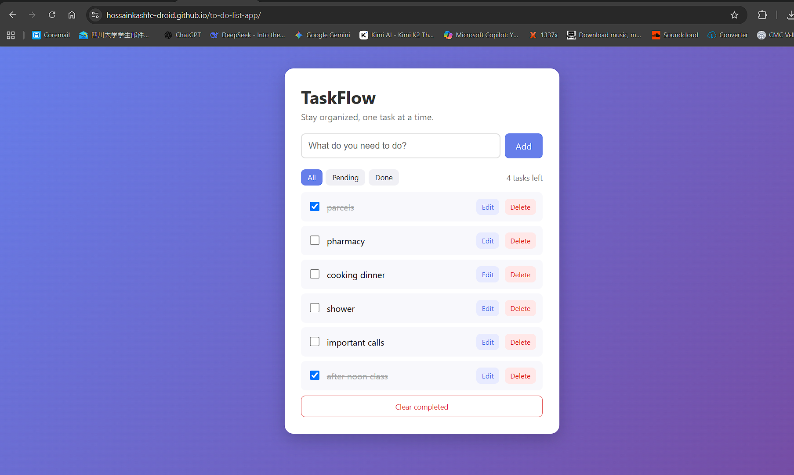

# TaskFlow - To-Do List App

A clean, responsive to-do list app built with vanilla JavaScript. Tasks are saved in the browser, so they are still there after a refresh.

**[Live Demo](https://hossainkashfe-droid.github.io/to-do-list-app/)**

## Features
- Add, edit, complete, and delete tasks
- Filter by All, Pending, or Done
- Live counter of remaining tasks
- Clear all completed tasks at once
- Data saved with localStorage
- Responsive design that works on phones

## Built With
- HTML5
- CSS3
- JavaScript (DOM manipulation, localStorage)

## Run Locally
1. Clone the repository
2. Open the folder in VS Code
3. Open `index.html` with Live Server